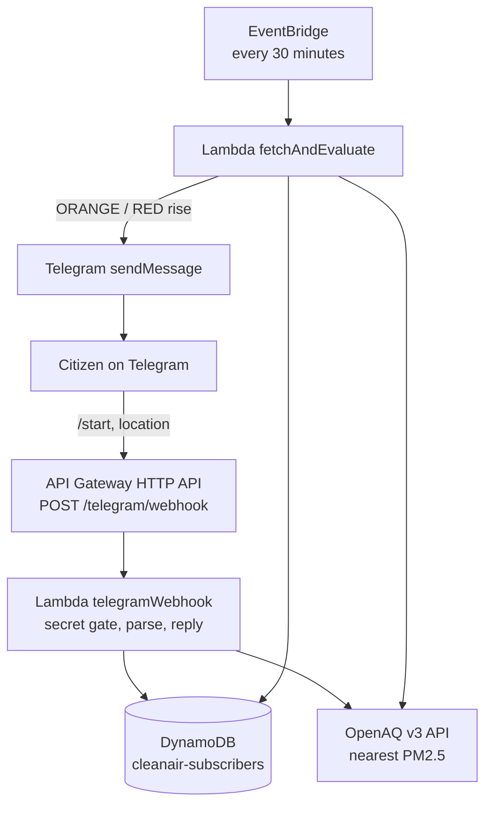

# VayuAQI

**Automatic air-quality alerts on Telegram.**
AWS Bharat Build · Track 01: Air · solo entry · live at **https://t.me/VayuAQI_bot**

> You share your location once. From then on, the air near you is checked every
> 30 minutes, and you get a message when it turns bad — once per rise, never
> repeated. No app, no account, no dashboard.

---

## The problem

Air-quality data is public, but it lands on charts and dashboards. A parent in
Delhi does not want to interpret an AQI number at 7am; they want to know whether
today is a bad day **for their street**, without opening anything. The data
exists — the delivery does not.

## What it does

1. Open the bot and send `/start`.
2. Tap **📍 Share my location**. That is the entire sign-up.
3. Every 30 minutes, a scheduler checks the air for your ~2 km cell.
4. If it escalated into **ORANGE or RED**, you get a message with the reading and
   a plain-language action plan — exactly once per rise.
5. `/status` gives the current reading on demand. `/stop` makes it go quiet.

### The alert it sends

```
⚠️ Air alert — the air in your area is ORANGE (AQI 208).

PM2.5 105 µg/m³, measured 06:00 UTC
Station: Ghaziabad - DPCC

What to do:
Avoid heavy outdoor exertion — running, cycling, outdoor workouts. Keep windows closed on busy roads and wear an N95 mask outdoors if you can.

Advisories are guidance based on hourly PM2.5 estimates and do not replace official orders from local authorities.
```

`/status` replies in the same shape, on demand. To print this whole conversation
locally with no AWS, no network and no bot token:

```bash
cd backend && npx tsx scripts/preview-bot.ts
```

## Architecture



### Where AWS is used

| AWS service | What it does here | Where |
|---|---|---|
| **API Gateway (HTTP API)** | The public HTTPS endpoint Telegram delivers updates to. Throttled to 10 rps / burst 20 so a rogue caller cannot run up the bill. | `template.yaml` → `HttpApi` |
| **Lambda — `telegramWebhook`** | Verifies Telegram's `X-Telegram-Bot-Api-Secret-Token` (403 otherwise), parses the update and runs the conversation. | `src/functions/telegramWebhook/` |
| **Lambda — `fetchAndEvaluate`** | The scheduler. Buckets subscribers by neighbourhood, reads OpenAQ once per neighbourhood, sends alerts on an ORANGE/RED rise. | `src/functions/fetchAndEvaluate/` |
| **DynamoDB** | One table, on-demand, partition key `chatId`. Holds only the ~2 km cell, the active/blocked flags and the last tier alerted. | `template.yaml` → `SubscribersTable` |
| **EventBridge** | `rate(30 minutes)` schedule that triggers the scheduler — this is why no laptop has to be open. | `template.yaml` → `FetchScheduleRule` |
| **CloudWatch** | One JSON log line per decision (`tier`, `aqi`, `locKey`, `alertsSent`). No secret is ever logged. | both Lambdas |
| **IAM** | Each Lambda's only inline policy is DynamoDB read/write scoped to that one table's ARN. | `template.yaml` → `Policies` |
| **CloudFormation + S3** (via **AWS SAM**) | The whole backend is one `template.yaml`; SAM builds the TypeScript with esbuild and uploads it through its own artifact bucket. | `backend/template.yaml` |

### The rest of the stack

| Technology | Why it is here |
|---|---|
| **Telegram Bot API** | Where the user already is: no app to install, no business verification, free. Webhooks in, `sendMessage` out (with 4096-char splitting and 403/429 handling). |
| **OpenAQ v3** | Nearest PM2.5 station within 25 km, with freshness checks and typed errors (`no_station`, `stale_data`). |
| **TypeScript 5**, strict | All decision logic is typed and pure; no `any`. |
| **Node.js 20** runtime, **ES2022** output | Matches the Lambda runtime; code is bundled, no dependency shipping. |
| **AWS SDK v3** (`client-dynamodb`, `lib-dynamodb`) | DynamoDB access from both Lambdas; no ORM. |
| **esbuild** (through SAM) | Bundles each handler to a ~1.3 MB `index.js`; this is the `Metadata: BuildMethod: esbuild` in the template. |
| **Vitest** | **119 tests**, no AWS, no network: AQI maths, tier boundaries, de-duplication, the conversation flows, the fan-out, the webhook secret gate. AWS, OpenAQ and Telegram are mocked at the edge, never mocked away. |
| **tsx** | Runs the offline preview and the no-deploy local bot runner. |
| **GitHub** | Source of truth; the deploy is reproducible from the template alone. |

## Design choices worth pointing at

- **One OpenAQ lookup per neighbourhood.** Coordinates are snapped to a ~2 km
  grid (`locKey`), so a thousand subscribers in one area still cost **one** call
  per cycle instead of a thousand (`runCitizenFanout` in `src/lib/fanout.ts`).
- **Privacy by rounding.** Only the ~2 km cell is stored — never an exact
  address, never a phone number, never contacts or message history.
- **Alert once per rise.** `shouldAlert(previousTier, newTier)` fires only on an
  escalation into ORANGE or RED, and each subscriber carries their own
  `lastAlertTier`.
- **A failed send is retried, not lost.** If Telegram refuses a message, the tier
  is deliberately *not* recorded, so the next run tries again.
- **One copy of the decision logic.** The scheduler and the webhook share the
  same pure modules in `src/lib`; there is no second implementation.
- **Least privilege and throttling by default**, so a public link cannot become a
  public bill.

## Repo layout

```
backend/
  template.yaml                        SAM: 1 table, 2 Lambdas, 1 HTTP API, 1 schedule
  src/lib/                             pure logic, no AWS calls
    aqi.ts          CPCB PM2.5 -> AQI (interpolated breakpoints)
    tiers.ts        AQI -> GREEN/YELLOW/ORANGE/RED + the alert de-dupe rule
    advisory.ts     English action plan per tier + the disclaimer
    openaq.ts       nearest-station lookup, freshness checks, typed errors
    telegram.ts     Bot API client (send, split, 403/429) + Update parser
    subscribers.ts  subscriber rows, ~2 km locKey grouping
    bot.ts          the conversation: /start, location, /status, /stop
    fanout.ts       the 30-minute monitoring cycle
  src/functions/
    telegramWebhook/   webhook Lambda (secret gate -> conversation)
    fetchAndEvaluate/  scheduler Lambda (fan-out)
  scripts/
    preview-bot.ts        prints every message the bot sends, fully offline
    tg-local.ts           live bot without deploying (long polling)
    validate-template.mjs structure check for machines without the SAM CLI
  src/tests/            vitest, 119 tests, everything external mocked
```

## Run it

```bash
cd backend
npm install
npm test                        # 119 tests, no AWS and no network needed
npm run typecheck               # tsc --noEmit, strict
npx tsx scripts/preview-bot.ts  # read the exact chat the bot produces
```

### Try the real bot from your phone, with no deploy

Put a BotFather token in `.env` (see `.env.example`), then:

```bash
npx tsx scripts/tg-local.ts            # long polling: send /start and go
npx tsx scripts/tg-local.ts --fanout   # run the alert job once, for real
npx tsx scripts/tg-local.ts --store    # see the stored rows
npx tsx scripts/tg-local.ts --reset    # forget lastAlertTier, so --fanout fires again
```

Telegram cannot call `localhost`, so instead of a webhook this asks Telegram for
updates and drives the **same** parser, conversation, Bot API and OpenAQ code the
Lambdas use — only DynamoDB is swapped for a JSON file in `backend/.localstore/`.

## Deploy it

Everything below was run on this project before being written down. Region is
**ap-south-1 (Mumbai)**; the stack is **`clean-air-planner`**.

### 1. Prerequisites

```bash
aws sts get-caller-identity     # an account that may create CloudFormation/Lambda/DynamoDB/S3 resources
sam --version                   # SAM CLI 1.x
node -v                         # v20 or newer
```

Two notes that cost an hour if you miss them:

- **On Windows Git Bash call `sam.cmd`, not `sam`** — Git Bash does not do
  `PATHEXT` lookup, so a bare `sam` reports "command not found" even when the CLI
  is installed.
- **`sam build` needs `esbuild` on `PATH`.** Use `npm run build` (npm puts
  `node_modules/.bin` on `PATH`); a plain `sam build` fails with *"Cannot find
  esbuild"* unless you `export PATH="$PWD/node_modules/.bin:$PATH"` first.
- If a second credential profile on your machine is denied by an organisation
  SCP, pass `--profile <name>` on every AWS and SAM command (`sam deploy` alone
  silently picks `default` and dies with `AccessDenied`).

### 2. Values

Copy the tracked example and fill in the three values:

```bash
cp .env.example .env           # from the repo root, then edit it
cd backend
set -a; source ../.env; set +a # nothing loads .env by itself
```

| SAM parameter | Value |
|---|---|
| `OpenAQApiKey` | free key from <https://explore.openaq.org> — NoEcho |
| `TelegramBotToken` | from **@BotFather** → `/newbot` — NoEcho |
| `TelegramWebhookSecret` | `openssl rand -hex 32` (1–256 chars of `A-Za-z0-9_-`) — NoEcho |
| `Stage` | `prod` (default) |

Secrets go on the command line, never into a config file: `sam deploy --guided`
writes every answer into `backend/samconfig.toml` in plaintext, which is why that
file is gitignored. Never put AWS access keys in `.env` — the CLI reads
`~/.aws/credentials`.

### 3. Build and deploy

```bash
npm test                # green before you deploy anything
npm run build           # = sam build; must print "Build Succeeded"

sam.cmd deploy --profile <your-profile> --region ap-south-1 \
  --parameter-overrides \
    OpenAQApiKey="$OPENAQ_API_KEY" \
    TelegramBotToken="$TELEGRAM_BOT_TOKEN" \
    TelegramWebhookSecret="$TELEGRAM_WEBHOOK_SECRET" \
    Stage=prod
```

`backend/samconfig.toml` supplies the stack name, `resolve_s3` and
`CAPABILITY_IAM`, so the line above is all you type. This creates: **1 DynamoDB
table, 2 Lambdas, 1 HTTP API, 1 EventBridge rule** — nothing that bills hourly.
To check the template before deploying: `sam.cmd validate --region ap-south-1`,
or `node scripts/validate-template.mjs` for a version that needs no Python.

### 4. Point Telegram at the Lambda

```bash
URL=$(aws cloudformation describe-stacks --stack-name clean-air-planner --profile <your-profile> \
  --region ap-south-1 --query "Stacks[0].Outputs[?OutputKey=='WebhookUrl'].OutputValue" \
  --output text)
echo "$URL"      # https://<api-id>.execute-api.ap-south-1.amazonaws.com/prod/telegram/webhook

curl "https://api.telegram.org/bot$TELEGRAM_BOT_TOKEN/setWebhook" \
  -d "url=$URL" \
  -d "secret_token=$TELEGRAM_WEBHOOK_SECRET" \
  -d 'allowed_updates=["message","my_chat_member"]'
```

Then confirm the registration and test from a phone: `/start` → share location →
a reading; `/status`; `/stop`.

```bash
curl "https://api.telegram.org/bot$TELEGRAM_BOT_TOKEN/getWebhookInfo"
```

Expect your URL and `pending_update_count` near 0. A 403 in
`last_error_message` means the secret in `setWebhook` and the secret in the
Lambda disagree.

## Prove the alert works without waiting 30 minutes

Run the scheduler by hand and read its summary:

```bash
aws lambda invoke --profile <your-profile> --region ap-south-1 \
  --function-name cleanair-fetch-evaluate-prod \
  --payload '{}' --cli-binary-format raw-in-base64-out out.json >/dev/null
cat out.json; rm -f out.json
```

```json
{"citizens":{"groups":1,"openAqFetches":1,"skippedGroups":0,"subscribers":1,
             "alertsSent":1,"blocked":0,"sendFailures":0}}
```

Run it again immediately: `alertsSent: 0` — the de-duplication working, because
you have already been told about this tier. The other numbers: `groups` =
neighbourhoods with at least one subscriber, `openAqFetches` = OpenAQ calls
actually made (**one per group**), `skippedGroups` = a station was unreadable
this cycle, `sendFailures` = Telegram refused (the tier is not recorded, so the
next run retries), `blocked` = the user blocked the bot and is never retried.

> Write to `out.json` and `cat` it, as above: `--payload '{}' /dev/stdout` does
> not work on Windows — the AWS CLI cannot open Git Bash's `/dev/stdout`.

**CloudWatch from Git Bash** needs one extra export, because Git Bash rewrites a
leading `/` in the log-group name into a path:

```bash
export MSYS_NO_PATHCONV=1
aws logs describe-log-streams --profile <your-profile> --region ap-south-1 \
  --log-group-name /aws/lambda/cleanair-fetch-evaluate-prod \
  --order-by LastEventTime --descending --max-items 1 \
  --query "logStreams[0].logStreamName" --output text
```

Each decision is one line: `{"msg":"fanout group done","locKey":"28.66,77.46",
"tier":"ORANGE","aqi":208,"members":1,"alerts":1,"skipped":0}`.

## What is deployed right now

Stack `clean-air-planner` = `CREATE_COMPLETE` in **ap-south-1**:

| Resource | Name |
|---|---|
| DynamoDB table | `cleanair-subscribers-prod` (pay-per-request, key `chatId`) |
| Lambda — scheduler | `cleanair-fetch-evaluate-prod` |
| Lambda — webhook | `cleanair-telegram-webhook-prod` |
| HTTP API | stage `prod`, throttling 10 rps / burst 20 |
| EventBridge rule | `cleanair-fetch-30min-prod`, `rate(30 minutes)`, enabled |

Verified against the live stack rather than by inspection: webhook **403**
without the secret and **200** with it; a real OpenAQ reading through the
deployed key (PM2.5 80 µg/m³, "R K Puram, Delhi - DPCC" → tier YELLOW, AQI 166);
the alert branch exercised with a temporary fixture row (Ghaziabad, ORANGE, AQI
208 → send attempted → `sendFailures: 1` and the tier left unrecorded so the next
run retries); the row then deleted. No NAT gateway, EC2 instance, RDS database or
load balancer exists in the account.

## Data stored

One row per chat in `cleanair-subscribers-<Stage>`, partition key `chatId`:

| Field | Meaning |
|---|---|
| `chatId` | the Telegram chat — the only identity kept |
| `lat` / `lng` / `locKey` | the shared location and its ~2 km cell |
| `active` | false after `/stop` |
| `blocked` | true once Telegram returns 403 |
| `lastAlertTier` | the last tier alerted about (de-duplication) |
| `firstName`, `createdAt`, `updatedAt` | logs and bookkeeping |

No phone numbers, no contacts, no message history.

## Cost

100% serverless and inside the free tier at any realistic demo scale: DynamoDB
on-demand with one table, two Lambdas, ~1,440 scheduled invocations a month, and
**one OpenAQ call per neighbourhood per cycle**. Guardrails: HTTP API throttling
(10 rps / burst 20), a blocked user is marked and never retried, and log groups
can be capped with `aws logs put-retention-policy`. Tear down with
`sam delete --stack-name clean-air-planner`.

## Honesty notes

- **Hourly, not the official 24-hour average.** CPCB AQI normally uses a 24-hour
  average PM2.5; this uses the latest hourly reading so the warning arrives while
  it is still useful. The measurement time and station are always shown, and
  advisories state that they are guidance and do not replace official orders.
- **Some Indian sensors report 1–3 days late**, so the bot picks the freshest
  nearby station and refuses readings it considers stale.
- **Advisories are generic guidance, not personal medical advice.** They tell
  sensitive groups to limit exertion and everyone else what to avoid; they never
  diagnose. A test asserts the wording stays in that register.
- **`nodejs20.x` is deprecated** (AWS blocks new functions on it from Feb 2027).
  The fix is one word — `nodejs22.x` in `template.yaml` — and the source already
  targets ES2022.
- **The one path verified by hand rather than automated** is a message reaching a
  real Telegram chat; that was checked with the deployed bot.

## Future scope

- **AI answers in chat** — ask "is it safe to go for a run?" and get an answer
  grounded in the same approved rules, with a rule-based fallback when the model
  is unavailable. Rules decide; AI only explains.
- **WhatsApp channel** — the same engine behind a different client (needs Meta
  business verification and paid templates).
- **Voice alerts (Amazon Polly)** — for low-literacy users.
- **Heatwave playbook (Track 02)** — the same scheduler, a temperature sensor
  instead of an air-quality one.
