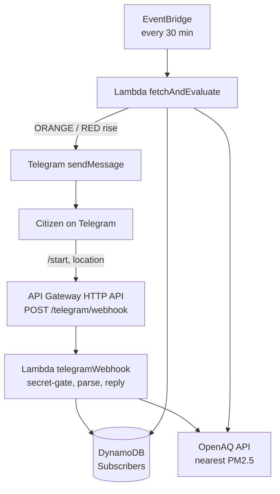

# Clean Air Telegram Bot

**AWS Bharat Build · Track 01: Air · Solo entry**

> You share your location once. When the air in your area turns bad, the bot
> messages you — you never have to check a dashboard or read an AQI chart.

## The problem

Air-quality data is public, but it lands on charts and dashboards. A parent in
Delhi does not want to interpret an AQI number at 7am; they want to know whether
today is a bad day, for *their* street, without opening anything.

## What it does

1. A person opens the bot and sends `/start`.
2. They tap **📍 Share my location**. That is the entire sign-up.
3. Every 30 minutes a scheduler checks the air for their neighbourhood.
4. If it escalated into **ORANGE or RED**, they get a message with the reading
   and a plain-language action plan — **once per rise, never repeated**.
5. `/status` gives the current reading on demand. `/stop` makes it go quiet.

Nothing else is required: no account, no email, no app, no dashboard.

## Example

```
⚠️ Air alert — the air in your area is RED (AQI 346).

PM2.5 180 µg/m³, measured 06:00 UTC
Station: DPCC Anand Vihar

What to do:
All outdoor activity stopped. Keep everyone indoors with windows closed...
```

Run `cd backend && npx tsx scripts/preview-bot.ts` to print this whole
conversation locally — no AWS, no token, no deploy.

## Architecture



| Service | Why |
|---|---|
| **Telegram Bot API** | Where the user already is — no app to install |
| **API Gateway HTTP API** | Gives Telegram an HTTPS webhook endpoint; throttled (10 rps / burst 20) |
| **Lambda** (Node 20, TypeScript) | Webhook + scheduler; free tier covers this load easily |
| **DynamoDB** (on-demand) | One `Subscribers` table keyed by `chatId` |
| **EventBridge** | 30-minute schedule, no servers |
| **OpenAQ v3** | Nearest PM2.5 station within 25 km |
| **AWS SAM** | One `template.yaml` = the whole backend as code |
| **CloudWatch** | Logs for every decision (secrets never logged) |

Two cost-saving design choices worth pointing at:

- **One lookup per neighbourhood.** Subscribers' coordinates are snapped to a
  ~2 km grid, so a thousand people in one area still cost **one** OpenAQ call
  per cycle (see `runCitizenFanout` in `backend/src/lib/fanout.ts`).
- **Privacy by rounding.** Only the ~2 km cell is stored — never an exact
  address, never a phone number, never contacts.

## Repo layout

```
backend/
  template.yaml                        SAM: 1 table, 2 Lambdas, 1 HTTP API, 1 schedule
  src/lib/                             pure logic, no AWS calls
    aqi.ts          CPCB PM2.5 -> AQI (interpolated breakpoints)
    tiers.ts        AQI -> GREEN/YELLOW/ORANGE/RED + the alert de-dupe rule
    advisory.ts     English action plan per tier
    openaq.ts       nearest-station lookup, freshness checks, typed errors
    telegram.ts     Bot API client (send, split, error mapping) + Update parser
    subscribers.ts  subscriber rows, ~2 km locKey grouping
    bot.ts          the conversation: /start, location, /status, /stop
    fanout.ts       the 30-minute monitoring cycle
  src/functions/
    telegramWebhook/   webhook Lambda (secret gate -> conversation)
    fetchAndEvaluate/  scheduler Lambda (fan-out)
  scripts/
    preview-bot.ts        prints the whole chat with no deploy
    validate-template.mjs template.yaml check for machines without the SAM CLI
  src/tests/            vitest, 124 tests, every AWS/OpenAQ/Telegram call mocked
docs/TELEGRAM_BOT.md    deploy + setWebhook runbook and test checklist
```

## Run it

```bash
cd backend
npm install
npm test                       # 124 tests, no AWS and no network needed
npx tsx scripts/preview-bot.ts # read the exact chat the bot produces
```

### Try the real bot from your phone, with no deploy

Put your BotFather token in `.env` (see `.env.example`), then:

```bash
npx tsx scripts/tg-local.ts            # long polling: /start and go
npx tsx scripts/tg-local.ts --fanout   # run the alert job once, for real
```

Telegram cannot call `localhost`, so this asks Telegram for updates instead of
receiving a webhook, and drives the same parser, flows, OpenAQ and Bot API code
the Lambdas use — only DynamoDB is swapped for a local JSON file. Details in
`docs/TELEGRAM_BOT.md` §5.

Deploy and connect Telegram: see **`docs/TELEGRAM_BOT.md`**. Short version — copy
`.env.example` to `.env` and fill in the three values first (`OPENAQ_API_KEY`,
`TELEGRAM_BOT_TOKEN`, `TELEGRAM_WEBHOOK_SECRET`):

```bash
cp .env.example .env           # then edit it
set -a; source .env; set +a    # nothing loads .env by itself; this exports it
npm run build                  # = sam build (npm puts esbuild on PATH for SAM)
sam.cmd deploy --parameter-overrides \
  OpenAQApiKey="$OPENAQ_API_KEY" \
  TelegramBotToken="$TELEGRAM_BOT_TOKEN" \
  TelegramWebhookSecret="$TELEGRAM_WEBHOOK_SECRET"

# then register the webhook (details in docs/TELEGRAM_BOT.md)
curl "https://api.telegram.org/bot<TOKEN>/setWebhook" \
  -d "url=<WebhookUrl from the deploy output>" -d "secret_token=<SECRET>"
```

On Windows Git Bash use `sam.cmd` — a bare `sam` is not found there. The stack
name, region, `resolve_s3` and `CAPABILITY_IAM` come from `samconfig.toml`,
which is **gitignored on purpose**: `sam deploy --guided` writes parameter
*values* into it in plaintext, so secrets are passed on the command line from
`.env` instead.

Then `/start` on a phone. To see an alert without waiting for bad air, invoke
the scheduler by hand:

```bash
aws lambda invoke --region ap-south-1 --function-name cleanair-fetch-evaluate-prod \
  --payload '{}' /dev/stdout
```

## Cost

100% serverless: DynamoDB on-demand, 2 Lambdas, ~1,440 scheduled invocations a
month, one OpenAQ call per neighbourhood per cycle. Well inside the free tier.
Tear down with `sam delete`.

## Honesty note

CPCB AQI normally uses a **24-hour average** PM2.5; this uses the **latest
hourly reading** as a real-time estimate so the alert arrives when it is still
useful. Advisories are **guidance only and do not replace official orders** from
local authorities. Some Indian sensors report 1–3 days late, so the bot picks the
freshest nearby station and always shows the measurement time.

## Future scope

- **AI answers in chat** — ask "is it safe to go for a run?" and get an answer
  grounded in the same rules, with a rule-based fallback (see `docs/AI_LAYER.md`).
- **WhatsApp** — same engine; needs Meta business verification and paid templates.
- **Voice alerts (Amazon Polly)** — for low-literacy users.
- **Heatwave playbook (Track 02)** — same engine, a temperature sensor instead.
