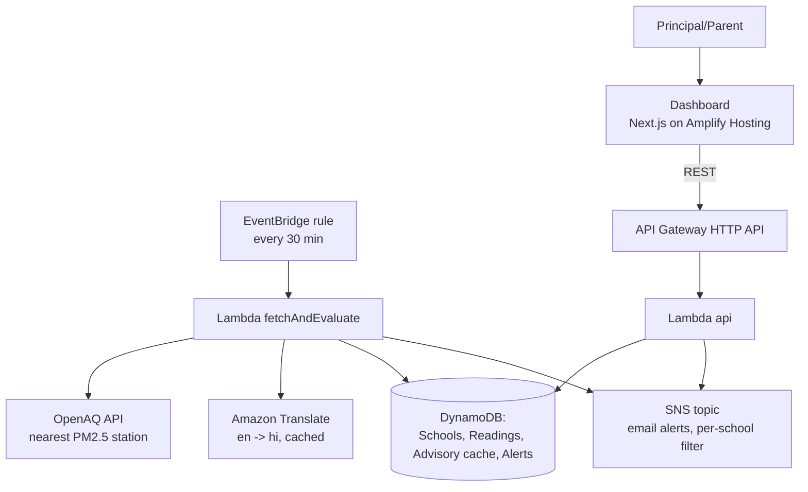

# Clean Air Day-Planner for Schools

**AWS Bharat Build · Track 01: Air · Solo entry**

> When the air turns bad, every school gets a clear, bilingual action plan before the first bell, automatically.

## The Problem

On high-pollution days, Indian schools find out too late. Principals don't know whether to cancel PE or assemblies, bus children are exposed on the way in, and parents get no clear guidance. The data exists (public AQI feeds), but nobody turns it into a *decision for a school*.

## The Solution

Any school registers with its name, city, coordinates and contact emails:

1. A scheduled job fetches the **nearest PM2.5 reading** (OpenAQ) every 30 minutes.
2. It is converted into a **CPCB AQI**, mapped to a risk **tier** (GREEN / YELLOW / ORANGE / RED).
3. Each tier maps to a clear **action plan**, shown in **English and Hindi** on the dashboard (Hindi via Amazon Translate, cached).
4. On an escalation to **ORANGE or RED**, an email alert with both languages goes out — **once per tier rise**, no spam.
5. The **Simulate severe day** button demonstrates the whole pipeline instantly for officials/judges.

## Architecture



| Service | Why it's used |
|---|---|
| **EventBridge** | 30-minute schedule, zero servers |
| **Lambda** (Node 20, TypeScript) | All backend logic; free tier covers this load easily |
| **DynamoDB** (on-demand) | Schools, readings (7-day TTL), advisory cache, alert history |
| **Amazon Translate** | English → Hindi action plans, cached once per tier |
| **SNS** | Email alerts with a per-school filter policy (`schoolId`) |
| **API Gateway** (HTTP API) | Dashboard backend, throttled (10 rps / burst 20) |
| **Amplify Hosting** | Public URL for the static dashboard |
| **AWS SAM** | One `template.yaml` = whole backend as code |
| **CloudWatch** | Logs + $5 budget alarm for cost safety |

## Screenshots

_(placeholder — add screenshots of dashboard, alert email, red-status demo)_

## Repo layout

```
backend/                    SAM app (template.yaml = all infra)
  template.yaml
  src/lib/                  aqi.ts, tiers.ts, advisory*.ts, openaq.ts, db.ts, evaluate.ts, alerts.ts
  src/functions/            fetchAndEvaluate/ (scheduler) and api/ (dashboard backend)
  src/tests/                vitest unit tests, all AWS mocked
frontend/                   Next.js 15 static export + Tailwind (app router)
docs/DEMO_SCRIPT.md         3-minute demo video script
```

## Run locally

```bash
# backend (deploy to your own AWS account, ap-south-1)
cd backend
npm install
npm test                      # 44 unit tests, no AWS needed
sam build
sam deploy --guided           # provide your OpenAQ key when asked

# frontend
cd ../frontend
npm install
NEXT_PUBLIC_API_URL=<ApiBaseUrl from deploy output> npm run build
npx serve out                 # or start Amplify build (next.config has output: 'export')
```

`ApiBaseUrl` is printed in the SAM deploy outputs. The frontend bakes the API URL in at build time.

## Deploy

1. `cd backend && sam build && sam deploy --guided` (stack `clean-air-planner`, region `ap-south-1`; the OpenAQ key is a NoEcho parameter).
2. Confirm email subscriptions: every added contact email receives an SNS confirmation link; alerts flow after confirmation.
3. Frontend: connect the repo to AWS Amplify Hosting, set `NEXT_PUBLIC_API_URL` env var, build command `npm run build`, output `out`.

## Cost notes

- 100% serverless (Lambda, DynamoDB on-demand, SNS, Translate, API Gateway, EventBridge).
- ~1,440 scheduled invocations/month + dashboard reads → well inside free tier.
- Amazon Translate cached per tier-language (max 8 rows — it stays free).
- AWS Budgets alarm at **$5** set on day one.
- Tear down after the hackathon: `sam delete` + delete the Amplify app.

## Honesty note (important)

CPCB AQI normally uses **24-hour average** PM2.5. This prototype uses the **latest hourly reading** as a real-time estimate for faster school decisions. Advisories are **guidance only and do not replace official orders** from local education authorities. The OpenAQ feed also depends on station availability; for cities without a nearby station, the **simulate** endpoint keeps the demo reliable.

## Future scope

- **Bedrock-personalized wording** — friendlier, per-school advisory drafts behind a feature flag (rule-based text remains the fallback and default: see `src/lib/bedrock*.ts` notes).
- **Polly voice alerts** — an audio action plan for parents with low literacy.
- **Heatwave playbook (Track 02)** — same engine, temperature sensor + hydration advisory.
- **District dashboard** — education officers view dozens of schools at once.

Love to the judges: schools shouldn't need to read AQI charts. They need an answer. This gives it.
